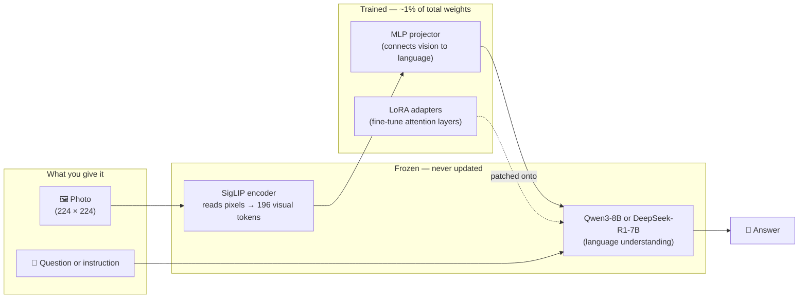

# Hale-VLM

<div align="center">

[](https://github.com/basaanithanaveenkumar/Hale-VLM)
[](https://basaanithanaveenkumar.github.io/Hale-VLM/)
[](https://github.com/basaanithanaveenkumar/Hale-VLM/blob/main/paper/main.tex)
[](LICENSE)
[](https://www.python.org/)

</div>

## How it works

A frozen image encoder reads the photo and converts it to a sequence of visual tokens. A tiny trainable MLP projector translates those tokens into the language model's vocabulary space. The frozen LLM — with small LoRA patches on its attention layers — reads both the visual tokens and your text prompt and generates an answer. Only ~1% of the total weights are ever updated.



> **Why freeze most of it?** The LLM already knows language deeply. You only need to teach it to *look* — the projector + LoRA do that in a fraction of the compute.

> **Note:** This repo has been merged into [Halo-VLM](https://github.com/basaanithanaveenkumar/Halo-VLM). Use the Halo-VLM repo for ongoing work — it contains both `src/hale_vlm/` and `src/halo_vlm/`.

Vision-language models built on Qwen3 and DeepSeek-R1 LLM backbones (and any other registered
HaleBlocks backbone), powered by [HaleBlocks](https://github.com/basaanithanaveenkumar/HaleBlocks).

## Install

Python 3.12+. `hale-blocks` is pulled from GitHub (`[tool.uv.sources]`).

```bash
uv sync --extra dev                # library + tests + ruff
```

| Extra | Adds | Needed for |
|---|---|---|
| `dev` | pytest, ruff, pre-commit | development |
| `notebooks` | matplotlib, jupyter tooling | backbone notebooks and `hale-vlm-films` |
| `ray`, `webdataset`, `distributed` | Ray Train, WebDataset shards | `train.ray.enabled`, `data.webdataset.enabled` |
| `deploy` | onnx, onnxruntime, safetensors | `hale-vlm-deploy` (offline ONNX route) |
| `deploy-nvidia`, `deploy-apple`, `deploy-amd`, `deploy-qualcomm` | vendor SDKs | TensorRT, MLX, MIGraphX / Ryzen AI, Qualcomm AI Hub |

The package imports without any extra: optional dependencies are imported lazily where used.

## Quick start

```python
from hale_vlm.config import load_vlm_config
from hale_vlm.models import build_vlm

cfg = load_vlm_config("configs/base.yaml", ["model.llm.use_lora=true"])   # inherits + overrides
model = build_vlm(cfg)                                                      # downloads weights
```

```bash
hale-vlm-train configs/overfit.yaml --cfg-options train.steps=20     # smoke test
hale-vlm-chat configs/base.yaml --image cat.jpg --prompt "What is in this image?"
pytest -q                                                            # 150+ tests, no network/GPU
```

Configs inherit with `inherits: base.yaml` (or `_base_`), deep-merge over the base, and accept
dotted `--cfg-options key=value` overrides. Library errors derive from
`hale_vlm.exceptions.HaleVLMError`. Architecture, class and sequence diagrams are in
[docs/architecture.md](docs/architecture.md).

## Scaling out: Ray Train + WebDataset

Both are off by default (`uv sync --extra distributed`):

```yaml
train:
  ray: {enabled: true, num_workers: 8, use_gpu: true}    # DDP on Ray workers, fault tolerant
data:
  webdataset: {enabled: true, root: data/webdataset}     # encode once -> tar shards -> stream
```

`hale-vlm-train configs/examples/ray_webdataset.yaml` · details in [docs/distributed.md](docs/distributed.md).

## Resources

| | |
|---|---|
| Paper (arXiv source) | [`paper/main.tex`](paper/main.tex) — build with `make -C paper` |
| Project page | [basaanithanaveenkumar.github.io/Hale-VLM](https://basaanithanaveenkumar.github.io/Hale-VLM/) ([source](project-page/index.html)) |
| Documentation | [`docs/`](docs/README.md) — getting started, configuration, data, [known issues](docs/known-issues.md) |
| Architecture diagrams | [`docs/architecture.md`](docs/architecture.md) (Mermaid) |
| VLM backbone notebooks | [Qwen3-VL](notebooks/backbones/vlm/qwen3_vl_backbone_step_by_step.ipynb) and [SmolVLM](notebooks/backbones/vlm/smolvlm_backbone_step_by_step.ipynb) step by step, with animations and checks against `transformers` ([overview](docs/vlm_backbone_notebooks.md)) |
| Blog | [Giving an 8B reasoning model eyes for about 1% of its parameters](docs/blog/2026-09-28-eyes-for-a-reasoning-llm.md) |
| Claude Code skills | [`.claude/skills/`](.claude/skills) — `hale-vlm-dev`, `hale-vlm-train`, `hale-vlm-datasets`, `hale-publish` |

## Vision projectors

`model.vision.projector_type` selects how vision features reach the LLM: `mlp`, `linear`, `qformer` (BLIP-2 style learned queries) or
`gated_cross_attention` (Flamingo style). See [docs/vision_connectors.md](docs/vision_connectors.md).

## Deployment

`hale-vlm-deploy` exports the VLM - split into a vision engine, a language model (graph or HF
checkpoint) and a single-graph prefill - to TensorRT / TensorRT-LLM / Jetson, MLX / mlx-lm,
AMD MIGraphX / Ryzen AI NPU and Qualcomm AI Hub / ExecuTorch QNN, with numerical parity checks.
See [docs/deploy.md](docs/deploy.md); configs live in `configs/deploy/`, vendor SDK sources in
`ext_pkgs/` (git submodules).

```bash
hale-vlm-deploy run configs/deploy/tiny_vision_onnx_ort.yaml        # offline smoke test
hale-vlm-deploy run configs/deploy/vision_tensorrt_fp16.yaml --cfg-options adapter.checkpoint=last.pt
```
