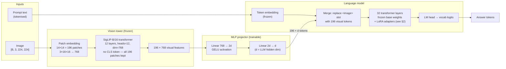
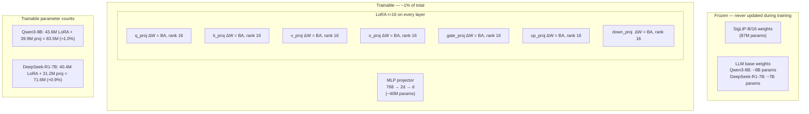
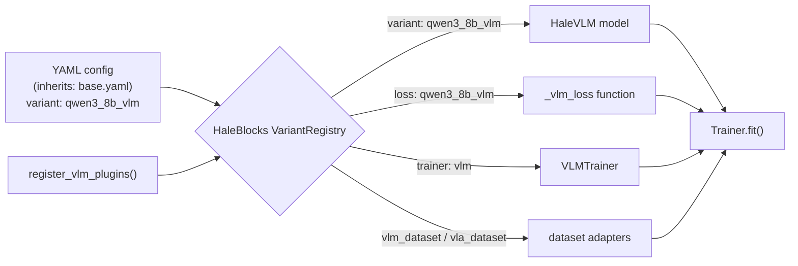
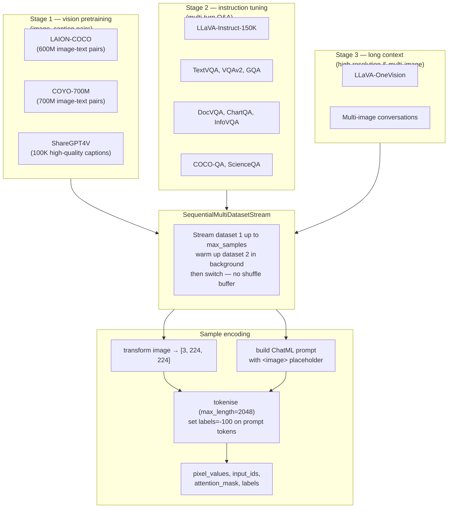
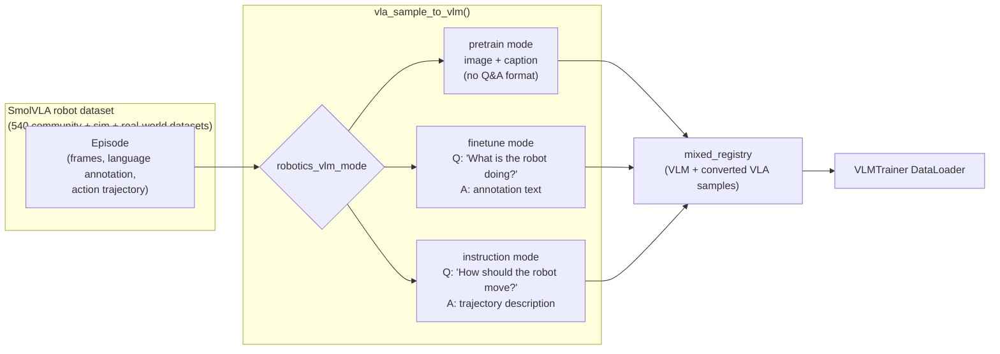
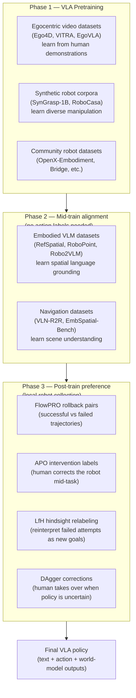
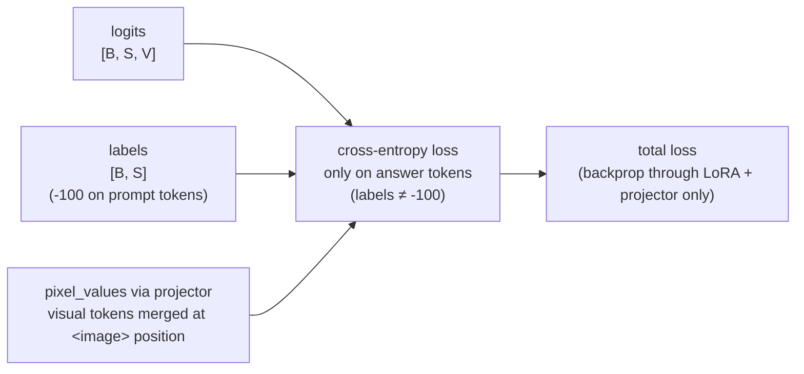
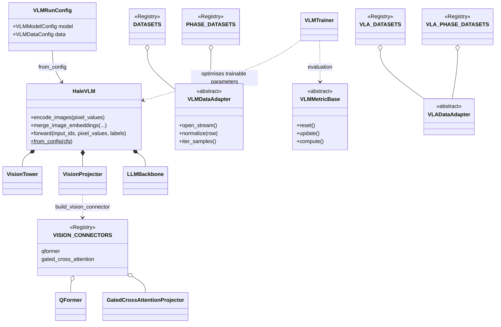
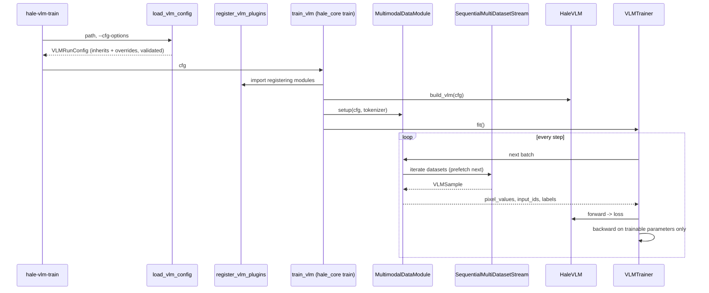
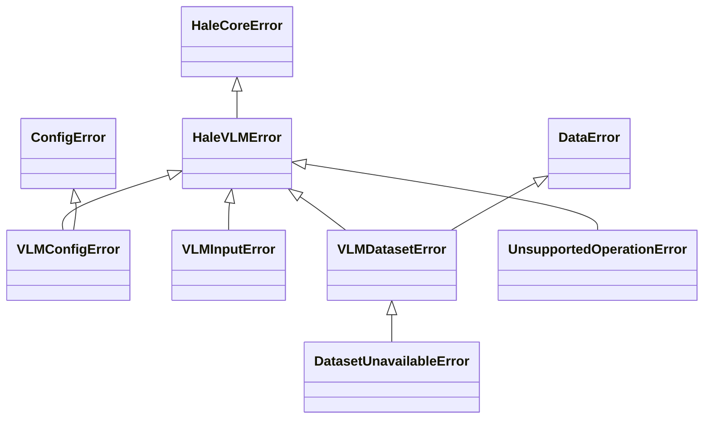

# Architecture

Mermaid diagrams (render on GitHub). They match the [project page](../project-page/index.html)
and Section 3 of the [paper](../paper/main.tex).
For known pipeline issues see [known-issues.md](known-issues.md).

---

## 1. End-to-end model

A frozen vision encoder converts the image to 196 visual tokens. A trainable MLP projector translates those tokens into the LLM's embedding space. The frozen LLM base (Qwen3-8B or DeepSeek-R1-Distill-Qwen-7B) with small LoRA adapters generates the answer.

---

## 2. LoRA adapter placement

Only ~1% of total parameters are updated: the MLP projector (always) and LoRA r=16 adapters on 7 linear modules in every transformer layer.

---

## 3. Plugin wiring (HaleBlocks registry)

---

## 4. SmolVLM data pipeline (three stages)

---

## 5. VLA robot data → VLM samples

---

## 6. Three-phase VLA training pipeline

---

## 7. Loss computation

---

## 8. Package structure (class diagram)

Registries are `hale_core` `NamedRegistry` instances (duplicate keys raise, unknown keys list the
registered names). `get_dataset` and `get_vla_dataset` fall back from the SmolVLM / SmolVLA
registries to the phase registries, so a config can name a dataset without knowing which holds it.

## 9. Training run (sequence diagram)

## 10. Error hierarchy

Each VLM error also derives from the built-in the call site raised before (`ValueError`,
`NotImplementedError`), so existing `except` clauses keep working.

## 11. Sources and versions

Resolved in `uv.lock` at the time of this revision: transformers 5.16.1, torch 2.13.0, peft 0.20.0,
pydantic 2.13.5, datasets 5.0.1, torchvision 0.28.0, accelerate 1.14.0, loguru 0.7.3. Model
families follow their Hugging Face model cards (Qwen3, DeepSeek-R1-Distill-Qwen, SigLIP); the
Q-Former follows BLIP-2 (Li et al., 2023), the gated cross-attention connector Flamingo
(Alayrac et al., 2022), the dataset catalogs SmolVLM (arXiv:2504.05299) and SmolVLA
(arXiv:2506.01844).
