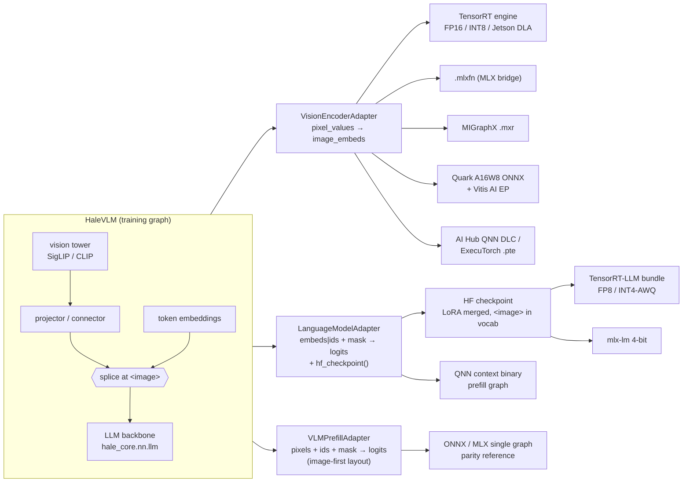
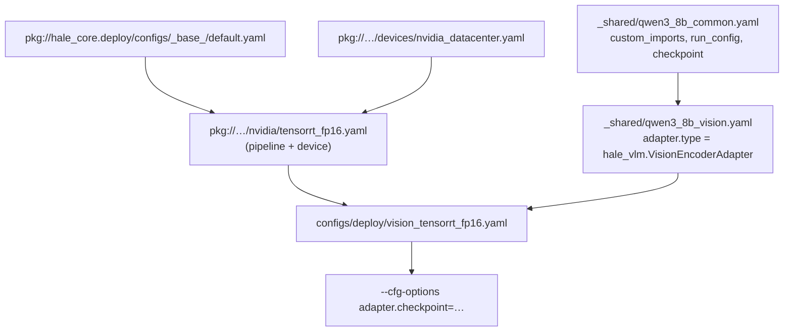

# Deploying Hale-VLM

`hale-vlm-deploy` exports the VLM to **NVIDIA** (TensorRT 10/11, Jetson DLA, TensorRT-LLM),
**Apple Silicon** (MLX, mlx-lm), **AMD** (MIGraphX on Instinct/Radeon, Quark + Vitis AI EP on the
Ryzen AI NPU) and **Qualcomm** (AI Hub QNN / ExecuTorch QNN on Snapdragon). It is a thin layer
over HaleBlocks' deployment framework (`hale_core.deploy`): this repo contributes **adapters**
(how to build and call each part of the VLM) and **configs** (which part goes to which target);
the stages, registries, config inheritance and parity checks live in HaleBlocks.

## Why the VLM is split

`HaleVLM.forward` splices image embeddings wherever `<image>` appears using data-dependent
indexing (`nonzero`, `.item()`), which no exporter can trace, and production VLM runtimes do not
run a VLM as one graph anyway: the vision tower runs once per image, the LLM decodes many tokens
with a KV cache. The deployment therefore splits the model:



The single-graph `VLMPrefillAdapter` uses the fixed on-device layout `[N visual tokens][T text
tokens]`; the unit tests prove it equals `HaleVLM.forward` for a prompt that starts with `N`
placeholders.

## On-device inference with the split

```mermaid
sequenceDiagram
    participant App
    participant Vision as Vision engine (TensorRT / NPU / MLX)
    participant LLM as LLM runtime (TensorRT-LLM / mlx-lm / QNN)
    App->>Vision: pixel_values [1, 3, S, S]
    Vision-->>App: image_embeds [1, N, D] (cached per image)
    App->>App: embed prompt ids, concat [image ; text]
    App->>LLM: prefill(inputs_embeds, attention_mask)
    LLM-->>App: logits of the last position, KV cache filled
    loop until <eos>
        App->>LLM: decode(next token)
        LLM-->>App: next-token logits
    end
```

## Parts × targets

| target | vision encoder | language model | full prefill | config(s) |
|---|---|---|---|---|
| NVIDIA data center / workstation | ✅ TensorRT FP16, INT8 (ModelOpt Q/DQ) | ✅ TensorRT-LLM FP8 | ONNX only | `vision_tensorrt_fp16`, `vision_tensorrt_int8_modelopt`, `llm_tensorrt_llm_fp8` |
| Jetson Orin | ✅ TensorRT FP16 on DLA + GPU fallback | ✅ TensorRT-LLM INT4-AWQ | – | `vision_jetson_orin_dla_fp16`, `llm_tensorrt_llm_int4_edge` |
| Jetson Thor | use the Orin/datacenter vision config | TensorRT-Edge-LLM (see notes) | – | – |
| Apple Silicon | ✅ MLX bridge FP16 (pending bridge fixes, see below) | ✅ mlx-lm 4-bit; ✅ MLX bridge prefill | MLX bridge (pending fixes) | `vision_mlx_fp16`, `llm_mlx_lm_q4`, `tiny_*_mlx_fp32` |
| mlx-vlm | ❌ `HaleVLM` is a custom architecture, not an mlx-vlm model type; use vision `.mlxfn` + mlx-lm text tower | | | – |
| AMD Instinct / Radeon | ✅ MIGraphX FP16 | ROCm builds of vLLM / SGLang from the HF checkpoint | – | `vision_migraphx_fp16` |
| AMD Ryzen AI NPU | ✅ Quark A16W8 + Vitis AI EP | ❌ 8B LLMs exceed the NPU flow (use the iGPU / OGA hybrid) | – | `vision_ryzen_ai_npu_a16w8` |
| Snapdragon 8 Elite / Gen 3 | ✅ AI Hub QNN DLC W8A16 (profiled), ✅ ExecuTorch QNN 16a8w | ✅ QNN context binary (≤ ~3B LLMs) | – | `vision_aihub_qnn_dlc_w8a16`, `vision_executorch_qnn_16a8w`, `llm_aihub_context_binary_w8a16` |

## Running

```bash
uv pip install -e ".[deploy]"            # + deploy-nvidia / deploy-apple / deploy-amd / deploy-qualcomm
hale-vlm-deploy env                      # which backends this machine has
hale-vlm-deploy list                     # stages, adapters (hale_vlm.*), runtimes
hale-vlm-deploy show configs/deploy/vision_tensorrt_fp16.yaml          # merged config (after _base_)
hale-vlm-deploy run  configs/deploy/vision_tensorrt_fp16.yaml \
    --cfg-options adapter.checkpoint=checkpoints/vlm/last.pt adapter.calibration_images=data/calib_images
```

Outputs go to `work_dirs/deploy/<name>/<stage>/` with `config.yaml` (resolved), `manifest.json`
(every artifact with size and sha256) and `report.json` (status and timing per stage).

Config layering (`_base_` = HaleBlocks' packaged target + this repo's adapter):



**CI / laptops without downloads:** `tiny_*` configs use `adapter.tiny_assets`, which writes a 2-layer
SigLIP and a 2-layer Llama (+ word-level tokenizer) to `work_dirs/tiny_vlm_assets` the first time -
real `transformers` architectures, so every route (including the HF checkpoint) is exercised offline.

## Verified here (Apple M-series, torch 2.13, ORT 1.31, MLX 0.32)

| config | result |
|---|---|
| `tiny_vision_onnx_ort` | ONNX (dynamo) → ORT, max abs error ≤ 5e-7 at min/opt/max shapes |
| `tiny_language_model_onnx_ort` | ≤ 2.1e-7 |
| `tiny_prefill_onnx_ort` | ≤ 3.6e-7 |
| `tiny_language_model_mlx_fp32` | MLX bridge, parity passes at min/opt/max |
| `tiny_text_lm_mlx_lm` | HF checkpoint written (LlamaForCausalLM + tokenizer with `<image>`); mlx-lm step skipped when not installed |
| `tiny_vision_mlx_fp32`, `tiny_prefill_mlx_fp32` | pending three HaleBlocks MLX-bridge changes (below); with them applied: ≤ 5e-7 |

Pending MLX-bridge changes (HaleBlocks): (1) `aten.convolution` must broadcast 1-element
`padding`/`stride`/`dilation` lists (SigLIP's patch embedding passes `padding=[0]`);
(2) `torch.export` should use `prefer_deferred_runtime_asserts_over_guards=True` (transformers'
mask code emits a guard `min(1024+16t, 2048+32t) == 1024+16t` the solver cannot prove for a dynamic
text length - the ONNX dynamo exporter already defers it); (3) converters for the symbolic-int ops
deferred asserts produce (`operator.le/lt/ge/gt/eq/ne`, `torch.sym_min/sym_max`).

## Research notes (October 2026)

* **TensorRT 11** is strongly typed only - the `FP16`/`INT8`/`FP8` builder flags and the INT8
  calibrator are gone; precision comes from the ONNX graph via
  [ModelOpt AutoCast](https://docs.nvidia.com/deeplearning/tensorrt/latest/api/migration/tensorrt-10x-to-11x-c-api-patterns.html)
  (mixed precision) or ModelOpt Q/DQ quantization. The TensorRT stage feature-detects 10 vs 11.
  [Release notes](https://github.com/NVIDIA/TensorRT/releases).
* **TensorRT-LLM 1.2** removed the TensorRT engine backend and `trtllm-build`; the PyTorch backend
  is the only one and serves HF-format checkpoints (ModelOpt-quantized for FP8 / NVFP4 / INT4-AWQ)
  - hence `LanguageModelAdapter.hf_checkpoint()` + `TensorRTLLMBundleStage`.
  [Release notes](https://nvidia.github.io/TensorRT-LLM/release-notes.html).
* **TensorRT-Edge-LLM** ([NVIDIA/TensorRT-Edge-LLM](https://github.com/NVIDIA/TensorRT-Edge-LLM),
  vendored in `ext_pkgs/`) is NVIDIA's on-device LLM/VLM runtime for Jetson Thor / DRIVE; it
  consumes its own ONNX export of HF checkpoints - use the HF checkpoint this repo writes.
* **MLX / mlx-lm / mlx-vlm**: `mlx_lm.convert` quantizes HF text models (4-bit, group 64);
  mlx-vlm only supports the model types it implements, so the custom `HaleVLM` goes through the
  ATen→MLX bridge for vision and mlx-lm for the text tower.
  [mlx-lm](https://pypi.org/project/mlx-lm/), [WWDC25 MLX](https://developer.apple.com/videos/play/wwdc2025/298/).
* **AMD ROCm 7.1+** removed ONNX Runtime's ROCm EP; MIGraphX (directly or as
  `MIGraphXExecutionProvider`) is the supported path.
  [ORT ROCm EP note](https://onnxruntime.ai/docs/execution-providers/ROCm-ExecutionProvider.html),
  [MIGraphX Python API](https://rocm.docs.amd.com/projects/AMDMIGraphX/en/docs-7.2.2/reference/MIGraphX-py.html).
* **Ryzen AI NPU** runs INT8/BF16 ONNX through the
  [Vitis AI EP](https://onnxruntime.ai/docs/execution-providers/Vitis-AI-ExecutionProvider.html);
  [Quark](https://quark.docs.amd.com/release-0.11/supported_accelerators/ryzenai/tutorial_a8w8_and_a16w8_quantize.html)
  `A16W8` is recommended for transformer encoders such as SigLIP.
* **Qualcomm AI Hub**: `qnn_context_binary` and `precompiled_qnn_onnx` compile targets were
  deprecated in 2026 - context binaries now come from `submit_compile_and_link_jobs`;
  `--quantize_full_type w8a16` is the usual NPU choice.
  [Release notes](https://workbench.aihub.qualcomm.com/docs/hub/release_notes.html),
  [API](https://workbench.aihub.qualcomm.com/docs/hub/api.html).
* **ExecuTorch QNN**: `to_edge_transform_and_lower_to_qnn` + `QnnQuantizer` (PT2E), QNN SDK 2.37
  recommended. [Qualcomm backend docs](https://docs.pytorch.org/executorch/1.0/backends-qualcomm.html).
