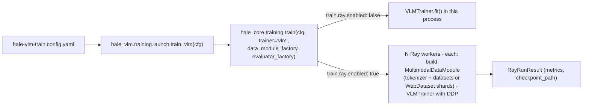

# Ray Train and WebDataset

Both features come from HaleBlocks (`hale_core.distributed.ray`, `hale_core.data.webdataset`;
design in HaleBlocks' `docs/distributed_training.md`). `VLMRunConfig` extends the HaleBlocks
`RunConfig`, so the `train.ray` and `data.webdataset` sections are available without
VLM-specific keys. Install with `uv sync --extra distributed`. Example config:
[`configs/examples/ray_webdataset.yaml`](../configs/examples/ray_webdataset.yaml).

## Ray Train

* `hale-vlm-train` calls `train_vlm(cfg)`, which goes through `hale_core.training.train`. With
  `train.ray.enabled: true`, `train.ray.num_workers` workers are started. Each worker builds its
  own `MultimodalDataModule` and `VLMEvaluator` through factories, so tokenizers and HF datasets
  are never pickled, and trains the LoRA + projector parameters with DDP.
* Map-style datasets get a `DistributedSampler` (reshuffled per epoch); streams split themselves.
* At every epoch end metrics and the checkpoint directory are reported to Ray. A failed worker
  group restarts from the last checkpoint, up to `max_failures` times.
* DDP options come from the config: `train.find_unused_parameters`, `gradient_as_bucket_view`
  and `static_graph`. Before this change they were silently ignored.

## WebDataset

With `data.webdataset.enabled: true`, `MultimodalDataModule` builds the train and validation
datasets **only if** their shards are missing or stale. That covers HF download, image decoding
and resizing, and prompt tokenisation, including the registry streams. It writes every encoded
`MultimodalSample` (pixel tensor, token ids, mask, labels, modality, dataset name) to
`<root>/<source>-<split>-<fingerprint>/shard-*.tar` and streams them back. The output is
identical to the non-WebDataset loader (tested).

The fingerprint covers the data section (source, datasets, sizes and limits), image size, max
length, image token and tokenizer. Changing those writes new shards. Training hyper-parameters,
LoRA settings and loader options do not trigger a re-conversion.

| key | default | meaning |
|---|---|---|
| `enabled` | `false` | convert + stream |
| `root` | `data/webdataset` | shard root |
| `samples_per_shard` | `1000` | samples per tar file; write ≥ ranks × `data.loader.num_workers` shards |
| `convert_workers` | `0` | parallel reads while converting |
| `shuffle_buffer` | `1000` | in-memory shuffle for training |
| `resample` | `auto` | equal-length epochs on every rank when several ranks train |
