# VLM backbone notebooks: Qwen3-VL and SmolVLM, step by step

Two notebooks rebuild the **backbone** of a production VLM from scratch in plain PyTorch, one
mechanism at a time. After every step, each notebook checks its result numerically against the
reference implementation in 🤗 `transformers`. They run on a laptop CPU in about a minute, with no
downloads. A tiny random-weight model keeps the real architecture, and an optional last cell repeats
the checks on the released weights.

| Notebook | What it covers | Checks vs `transformers` |
|---|---|---|
| [`qwen3_vl_backbone_step_by_step.ipynb`](../notebooks/backbones/vlm/qwen3_vl_backbone_step_by_step.ipynb) | `smart_resize` dynamic resolution, 16×16×2 block-major patchify, Conv3d ≡ Linear, interpolated position table + 2-D RoPE, packed `cu_seqlens` attention, 2×2 merger, DeepStack, interleaved M-RoPE, Qwen3 decoder (QK-norm, GQA) | 24, full backbone max error 3e-6 |
| [`smolvlm_backbone_step_by_step.ipynb`](../notebooks/backbones/vlm/smolvlm_backbone_step_by_step.ipynb) | resize + tile split + global view, `<row_r_col_c>` prompt tags, SigLIP with NaViT-style position buckets (padded tiles), pixel shuffle r = 4, `inputs_merger`, SmolLM2 (Llama) decoder, token budget vs Qwen3-VL | 15, full backbone max error 3e-6 |

## Animations

| Qwen3-VL | SmolVLM |
|---|---|
| 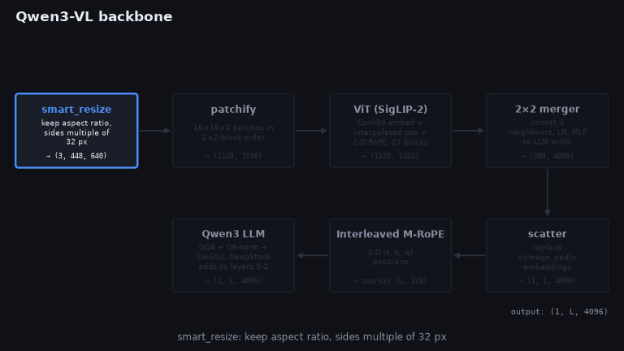 | 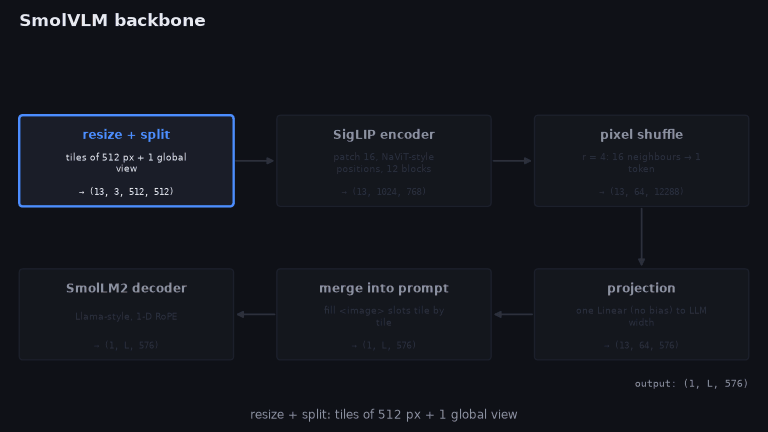 |
| 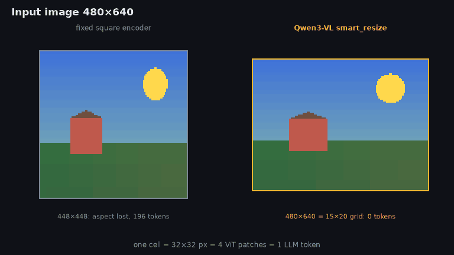 | 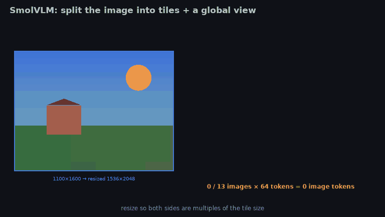 |
| 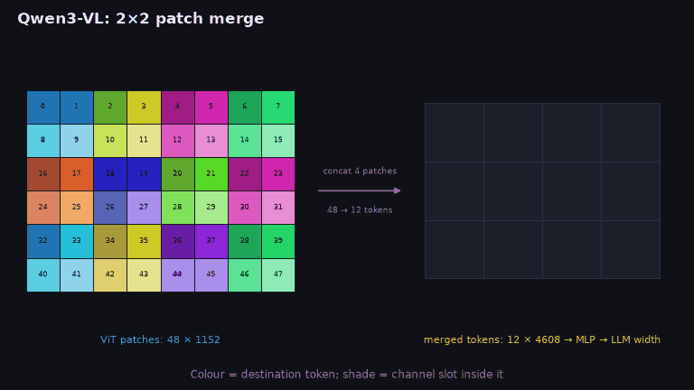 | 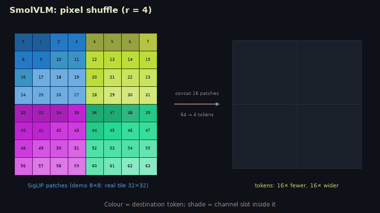 |
| 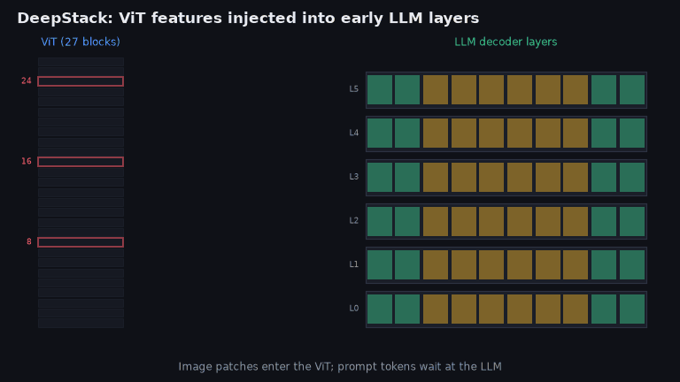 | 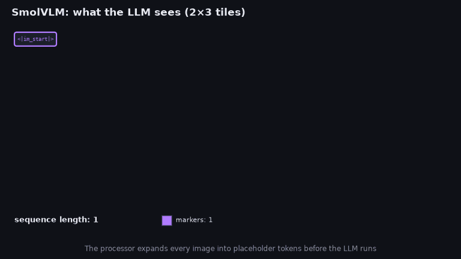 |
| 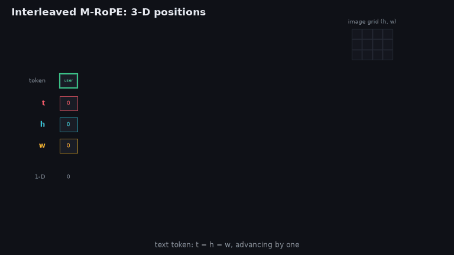 | |
| 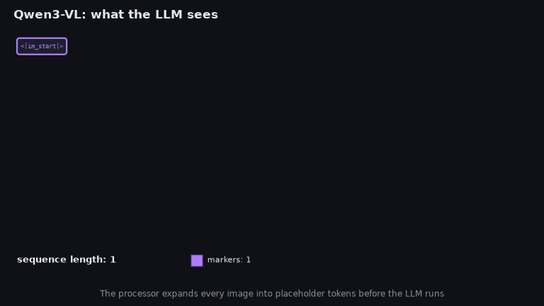 | |

The merge and pixel-shuffle films are driven by **measured** patch groupings.
`MergeMappingProbe` runs the library's own `patchify` / `pixel_shuffle` on an index image, so the
animation cannot drift from the code.

## Running

```bash
uv pip install -e '.[notebooks]'                      # matplotlib, ipykernel, nbclient
jupyter lab notebooks/backbones/vlm/                  # or open in VS Code
hale-vlm-films --out assets/backbone_films            # re-render every GIF
hale-vlm-films qwen3_vl_deepstack --out /tmp/films    # or just one
```

The notebooks put `src/` (and a sibling `../HaleBlocks/src` checkout, if present) on `sys.path`, so
they also work without an editable install.

## How the film package is built

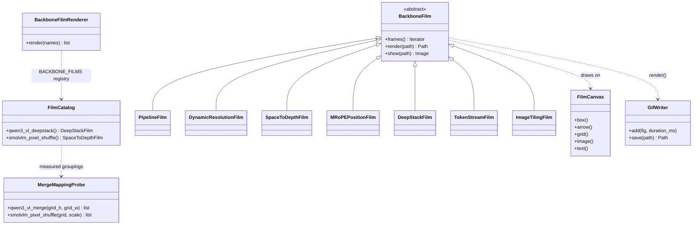

`BackboneFilm` is a Template Method: subclasses only yield frames, and the base class rasterises,
quantises and saves them. Films draw on standalone matplotlib `Figure`s, never `pyplot`, so they do
not change a notebook's plotting backend. Code lives in `src/hale_vlm/visualization/backbone_films/`
(one class per file), and the tests are in `tests/unit/test_backbone_films.py`.
